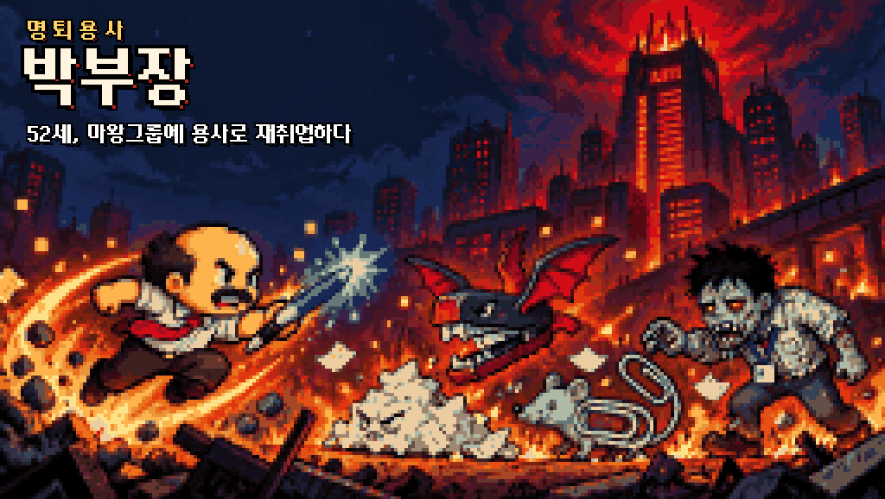
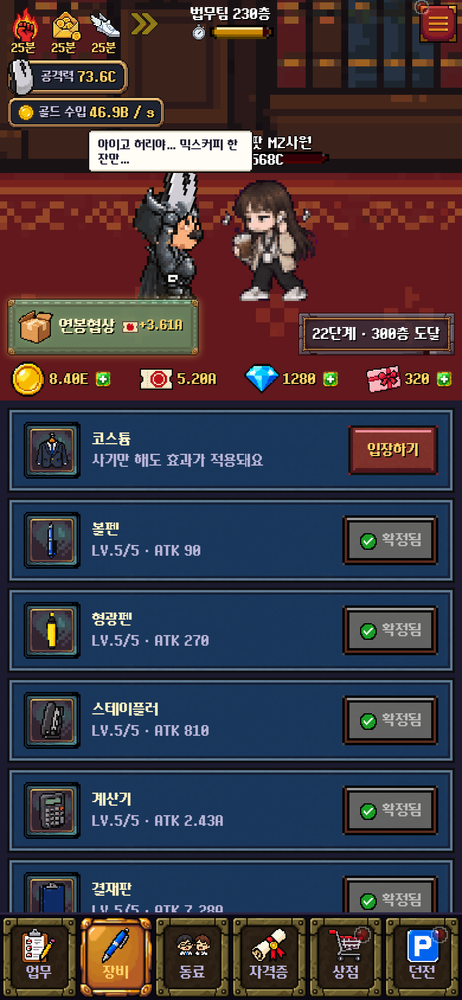
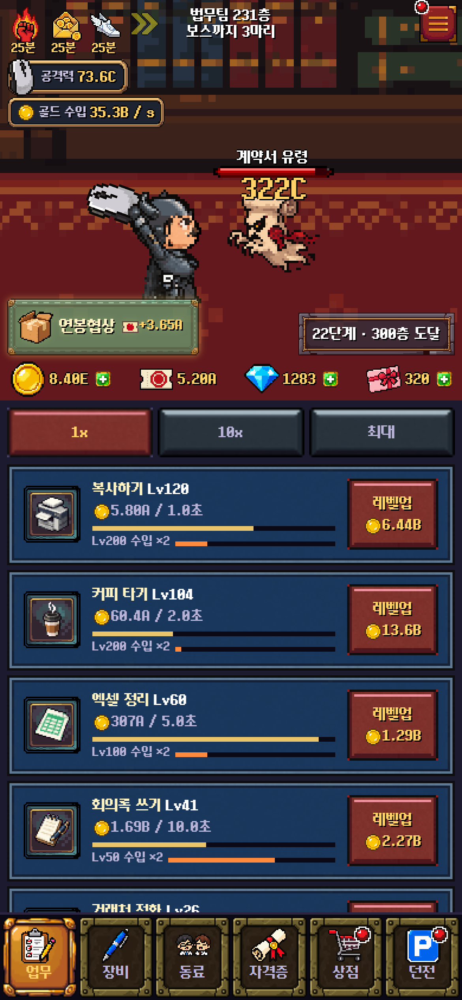
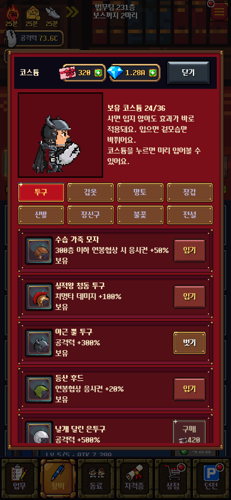
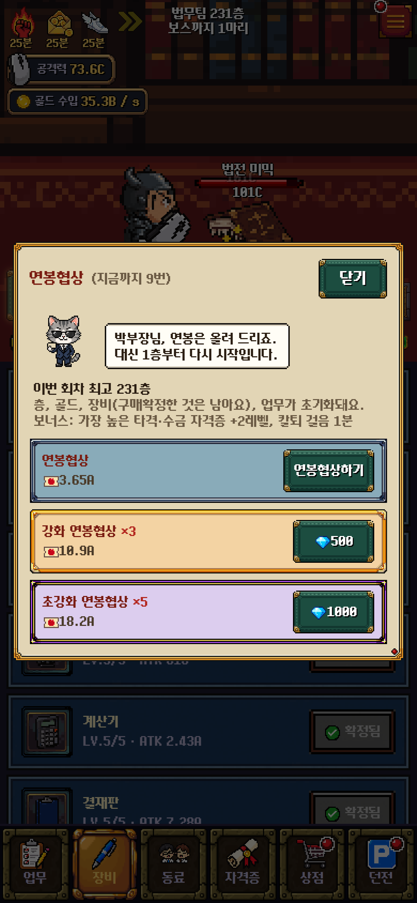
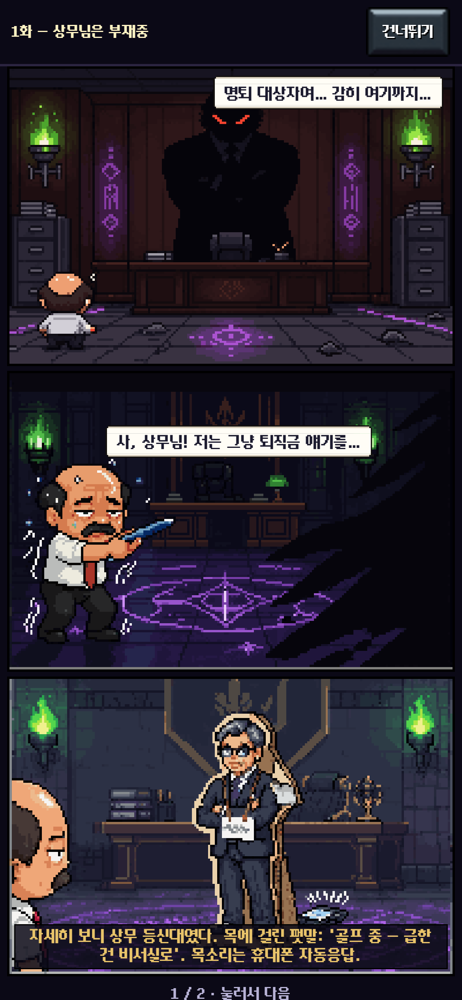

<p align="center">
  
</p>

<h1 align="center">명퇴용사 박부장</h1>

<p align="center">
  <b>52세, 마왕그룹에 용사로 재취업하다.</b><br>
  Verse8 세로형 방치 RPG · 도트 감성 · B급 직장인 개그
</p>

<p align="center">
  <a href="https://verse8.io/h3t6S8h"><b>▶ 게임 플레이하기</b></a>
</p>

## 소개

25년 다닌 회사에서 명예퇴직을 당한 박부장은 대출금과 학원비를 갚으려고 용사로 이직한다.
무대는 마왕그룹 본사 빌딩. 층은 끝이 없고, 볼펜 한 자루로 몬스터를 잡아 돈을 번다.

돈을 벌어 강해지고, 벽에 막히면 연봉협상해서 더 높이 오르는 루프이다.

## 게임 화면

<p align="center">
  
  
  
  
  
</p>

<p align="center">전투 · 보스 도전 · 코스튬 · 이직 제안서 · 웹툰</p>

## 플레이

Verse8 플랫폼에서 바로 플레이 가능: **https://verse8.io/h3t6S8h**

## 개발

Vite + React + TypeScript. 서버는 `server/src/server.ts`, 게임 규칙(정산·비용·보상)은 `shared/`에만 있다.

```bash
npm install
npm run server:install
npm run dev        # 터미널에 나온 주소 뒤에 ?local 을 붙이면 서버 없이 실행
npm test
npm run typecheck
npm run server:test
```

- 다른 PC 설정: [docs/SETUP.md](docs/SETUP.md)
- 배포 규칙: [docs/VERSE8.md](docs/VERSE8.md)
- 설계: [docs/superpowers/specs/2026-10-06-myeongtoe-hero-design.md](docs/superpowers/specs/2026-10-06-myeongtoe-hero-design.md)
- 아트: [art/README.md](art/README.md)
